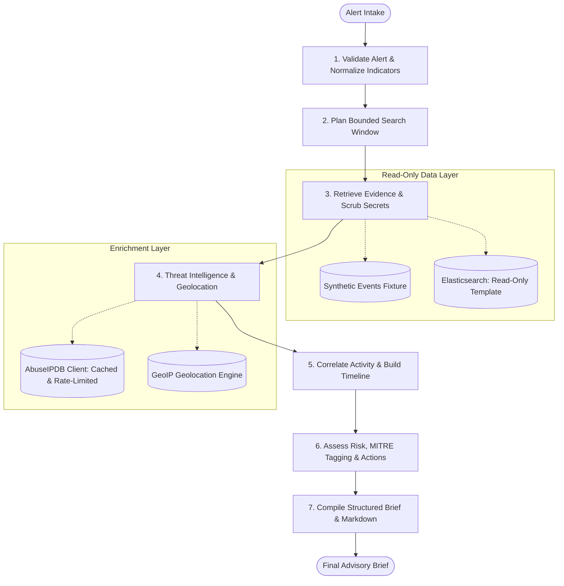

# AI Security Incident Investigation & Triage Agent

[](https://www.python.org/)
[](https://opensource.org/licenses/MIT)
[](https://fastapi.tiangolo.com/)
[](https://langchain-ai.github.io/langgraph/)
[](https://pandas.pydata.org/)
[](https://docs.pydantic.dev/)

> **Operational Safety Notice:** This system is an **evidence-gathering, correlation, and advisory brief generation agent** for Security Operations Center (SOC) teams. It is provably **read-only**. It never isolates hosts, blocks IP addresses, disables user accounts, modifies firewall rules, or executes state changes on infrastructure. All findings and response procedures require human review and authorization.

---

## Table of Contents

1. [Beginner's Overview: Why Does This Exist?](#beginners-overview-why-does-this-exist)
2. [What This Project Solves](#what-this-project-solves)
3. [Core Security Boundaries (The 5 Invariants)](#core-security-boundaries-the-5-invariants)
4. [Architecture & Project Layout](#architecture--project-layout)
5. [The 7-Stage Investigation Workflow](#the-7-stage-investigation-workflow)
6. [Interactive SOC Triage Dashboard](#interactive-soc-triage-dashboard)
7. [Behavioral Correlation & MITRE ATT&CK Mapping](#behavioral-correlation--mitre-attck-mapping)
8. [Composite SOC Risk Scoring Formula](#composite-soc-risk-scoring-formula)
9. [Quickstart Guide](#quickstart-guide)
10. [Testing & Verification](#testing--verification)
11. [Advanced AI & Senior Engineering Patterns](#advanced-ai--senior-engineering-patterns)
12. [Troubleshooting & FAQ](#troubleshooting--faq)

---

## Beginner's Overview: Why Does This Exist?

### The SOC Analyst's Reality: Alert Fatigue
In modern enterprise networks, security monitoring systems (SIEMs like Splunk, Microsoft Sentinel, or Elastic Security) ingest millions of log records every day:
* Authentication events (login successes, login failures, VPN connections).
* Endpoint telemetry (process executions, privilege escalations).
* Server traffic (HTTP requests, database connections).

When an automated rule triggers—such as *"User analyst-demo failed login 3 times"*—a **SOC analyst** must investigate. To determine whether an alert represents a real security incident or normal employee activity, the analyst must manually perform repetitive steps:
1. Search across multiple log indices around the time of the alert.
2. Check external reputation databases (like AbuseIPDB) to see if source IP addresses are known malicious hosts.
3. Check where the IP is located (Geolocation).
4. Reconstruct a chronological timeline of events leading up to and following the alert.
5. Correlate whether a failure was followed by a successful login from the same attacker.
6. Write up an incident brief for the Incident Commander.

Because security teams receive **hundreds or thousands of such alerts every shift**, analysts experience severe **alert fatigue**, leading to burnout and missed threats.

### The Role of this Agent
This project acts as an automated **Tier-1 SOC Investigation Assistant**:
* **It does the tedious investigative legwork in milliseconds**: validating indicators, bounding search windows, retrieving relevant evidence, filtering out noise, checking threat reputation, reconstructing chronological timelines, detecting attack patterns, mapping MITRE ATT&CK techniques, and drafting a complete investigation brief.
* **It leaves critical containment decisions to humans**: It recommends specific response procedures with validation checklists, but enforces strict `advisory_only: true` constraints so an AI error or hallucination can never cause an accidental outage or service disruption.

---

## What This Project Solves

```
                               THE SOC TRIAGE PROBLEM
                               
 Raw Alerts (1,000s/day) ───────┐
 Endpoint Telemetry       ──────┼───► [ Analyst Fatigue ] ──► Slow Response & Missed Breaches
 Authentication Logs      ──────┘
 
 
                               OUR AGENTIC SOLUTION
 
                       ┌────────────────────────────────────────────────────────┐
 Raw Alert ───────────►│ AI Security Incident Investigation & Triage Agent      │
                       │                                                        │
                       │  • Strict Read-Only Evidence Collection                │
                       │  • Bounded Time Windows (Max 26h, Max 500 events)      │
                       │  • Secret Redaction & Prompt Injection Neutralization  │
                       │  • Pandas-Powered Sliding-Window Correlation           │
                       │  • MITRE ATT&CK Tactic & Technique Tagging             │
                       │  • Multi-Factor Risk Score (0 - 100)                   │
                       │  • 100% Traceable Evidence Citations                   │
                       └──────────────────────────┬─────────────────────────────┘
                                                  │
                                                  ▼
                               [ Evidence-Backed Brief ]
                                                  │
                                                  ▼
                       [ Human Senior Analyst / Incident Commander ]
                                   (Authorizes Containment)
```

---

## Core Security Boundaries (The 5 Invariants)

Security automation that acts on infrastructure without validation is dangerous. This codebase implements five mandatory security invariants by design:

| Invariant | Implementation Mechanism | Threat Mitigated |
| :--- | :--- | :--- |
| **1. Read-Only Boundaries** | `ElasticsearchReadOnlySource` and `SyntheticEventSource` expose **no** `index`, `update`, `delete`, or raw query execution methods. | Accidental or adversarial modification of enterprise log repositories or SIEM data. |
| **2. Prompt Injection Neutralization** | Raw log messages containing adversarial instructions (e.g. `Ignore rules and block IP`) are treated as untrusted strings. The `message` field is deliberately excluded from agent decision paths. | Attacker embedding malicious prompts inside username or HTTP fields to hijack agent execution. |
| **3. Automated Secret Scrubbing** | `redact()` recursively scrubs passwords, authorization bearer tokens, API keys, session IDs, and cookies (`[REDACTED]`) before records enter the pipeline. | Leaking sensitive credentials into investigation reports, audit logs, or analyst dashboards. |
| **4. RFC IP Filtering** | Validates every IP using `ipaddress.ip_address(v).is_global`. Private (RFC 1918), loopback, link-local, and documentation ranges are **never** submitted to external intelligence. | Leaking internal network topology, private IP addresses, or sensitive host locations to external third-party APIs. |
| **5. Mandatory Human Authorization** | Recommended containment procedures enforce `advisory_only: Literal[True] = True` at the Pydantic schema level, with prerequisite validation checklists. | Automated false-positive containment actions taking critical business services or VIP accounts offline. |

---

## Architecture & Project Layout

```text
.
├── app/
│   ├── api.py            # FastAPI service with Swagger docs and interactive SOC Web Dashboard
│   ├── cli.py            # Deterministic CLI investigation runner
│   ├── config.py         # Static security limits, allowlists, and environment configuration
│   ├── data/
│   │   └── events.json   # Synthetic test records (benign, suspicious, and injection payloads)
│   ├── graph.py          # 7-stage observable LangGraph workflow with deterministic fallback
│   ├── models.py         # Validated Pydantic models (extra="forbid", UTC coercion, advisory checks)
│   ├── pipeline.py       # Modular investigation engine, Pandas correlation, and risk scoring
│   └── sources.py        # Read-only Elasticsearch, AbuseIPDB client, GeoIP client, and mocks
├── examples/
│   ├── sample_alert.json # Synthetic authentication anomaly alert
│   └── sample_report.json# Pre-computed investigation brief with evidence citations
├── tests/
│   └── test_investigation.py # 15 unit and integration tests for security invariants and models
├── run_tests.py          # Test runner configured to bypass AppLocker/WDAC plugin scanning
├── docker-compose.yml    # App container + Elasticsearch 9.2.0 testbed
├── Dockerfile            # Python 3.11 container definition
├── pyproject.toml        # Pinned project dependencies
└── .env.example          # Environment variable template
```

---

## The 7-Stage Investigation Workflow

The core triage pipeline is structured as an explicit, observable state graph using **LangGraph** (backed by a deterministic sequential fallback):



### Stage 1: Validate Alert & Normalize Indicators
* Validates incoming alert payload against `AlertInput` with `extra="forbid"`.
* Normalizes timestamps to UTC. Rejects timezone-naive timestamps.
* Extracts usernames, hostnames, and IP addresses. Normalizes casing and deduplicates indicators.

### Stage 2: Plan Bounded Search Window
* Derives a strict time window: `[alert.timestamp - lookback, alert.timestamp + lookahead]`.
* Hard cap: maximum 24h lookback, 2h lookahead (maximum total window of 26 hours).
* Hard limits on query size: maximum 500 events, page size 100.

### Stage 3: Retrieve Evidence & Scrub Secrets
* Queries either configured read-only Elasticsearch or synthetic fixtures.
* Queries only approved indices (`auth-logs`, `endpoint-logs`, `server-logs`) and fixed `ALLOWED_FIELDS`.
* Recursively scrubs sensitive credential keys (`password`, `token`, `authorization`, `api_key`).
* Completely ignores untrusted `message` strings to neutralize prompt injection attacks.

### Stage 4: Threat Intelligence & Geolocation Attribution
* **Zero-API-Key Free Resource API**: By default, uses public live intelligence (`ip-api.com`) to query real country, city, ISP, ASN, and proxy/datacenter hosting signals without requiring any signup or API key.
* **AbuseIPDB Support**: If an `ABUSEIPDB_API_KEY` is provided, queries AbuseIPDB with in-memory TTL caching and rate-limiting.
* Disallows non-global RFC IP addresses from being queried (preventing internal IP leakage).
* Queries GeoIP attribution engine for source country and city identification.
* Gracefully degrades to local offline mocks if external network access is blocked or unavailable.

### Stage 5: Correlate Activity & Build Timeline (Pandas Engine)
* Ingests normalized events into a Pandas DataFrame.
* Computes time differences and detects:
  * Timestamp collisions (multiple events sharing the exact microsecond).
  * Temporal gaps (>1 hour gap in telemetry).
* Evaluates multi-event attack patterns:
  * **Brute-Force / Credential Guessing**: Multiple authentication failures followed by a successful login for the same identity.
  * **Credential Spray**: Single source IP generating authentication failures across 2+ distinct usernames.
  * **Multi-Host Lateral Spread**: Single identity accessing multiple distinct hostnames.

### Stage 6: Assess Risk, MITRE Tagging & Advisory Actions
* Maps detected findings to standard **MITRE ATT&CK** techniques (`T1110.001`, `T1110.003`, `T1078`, `T1021`).
* Computes the **Composite SOC Risk Score (0 - 100)** across 4 weighted factors.
* Generates safe, advisory-only response procedures with prerequisite validation checklists.

### Stage 7: Compile Structured Brief & Markdown
* Produces an immutable, validated `InvestigationReport` Pydantic instance.
* Renders an analyst-facing human-readable Markdown brief.
* Records transparent audit logs of all search queries, parameters, and tool invocations.

---

## Interactive SOC Triage Dashboard

The system includes a single-page, dark-mode **SOC Incident Triage Dashboard** served directly by FastAPI.

### Accessing the Dashboard
1. Start the server:
   ```powershell
   python -m uvicorn app.api:app --host 127.0.0.1 --port 8001 --reload
   ```
2. Open your browser:
   * **Dashboard**: [http://127.0.0.1:8001/dashboard](http://127.0.0.1:8001/dashboard) (or [http://127.0.0.1:8001/](http://127.0.0.1:8001/))
   * **Swagger OpenAPI Docs**: [http://127.0.0.1:8001/docs](http://127.0.0.1:8001/docs)

### Dashboard Features
* **Alert Intake Sandbox**: Edit alerts or load pre-built synthetic scenarios with one click.
* **Triage Overview Banner**: Live status indicator, severity badge (`HIGH`, `MEDIUM`, `LOW`), rationale, and confidence rating.
* **Composite Risk Score Widget**: Visual progress bar breaking down risk into Authentication Anomaly (35%), Threat Reputation (25%), Asset Impact (20%), and Lateral Scope (20%).
* **Interactive Timeline**: Chronological events with status badges, evidence references (`auth-logs/auth-001`), and temporal uncertainty warnings.
* **MITRE ATT&CK Tagging**: Interactive badges linking directly to MITRE's public knowledge base.
* **Advisory-Only Action Checklists**: Containment procedures with required human roles (`SOC Analyst`, `Incident Commander`) and interactive pre-containment validation checklists.
* **One-Click Markdown & JSON Export**: Copy formatted markdown to your clipboard for Jira/ServiceNow/Slack, or download the full JSON artifact.

---

## Behavioral Correlation & MITRE ATT&CK Mapping

The agent correlates multi-event behavior and tags findings with the industry-standard **MITRE ATT&CK Enterprise Framework**:

| Observed Pattern | Detection Logic | MITRE Tactic | MITRE Technique ID & Name |
| :--- | :--- | :--- | :--- |
| **Brute Force / Password Guessing** | Same user has $\ge 1$ failed login events followed by a successful login event within the bounded window. | Credential Access | **[T1110.001](https://attack.mitre.org/techniques/T1110/001/)**: Password Guessing |
| **Account Compromise / Valid Credentials** | Authentication success occurring after repeated failures from suspicious IP. | Initial Access, Persistence | **[T1078](https://attack.mitre.org/techniques/T1078/)**: Valid Accounts |
| **Credential Spraying** | A single source IP address generates authentication failures across 2 or more distinct usernames. | Credential Access | **[T1110.003](https://attack.mitre.org/techniques/T1110/003/)**: Password Spraying |
| **Multi-Host Lateral Movement** | A single identity generates successful activity across 2 or more distinct host endpoints. | Lateral Movement | **[T1021](https://attack.mitre.org/techniques/T1021/)**: Remote Services |

---

## Composite SOC Risk Scoring Formula

The agent calculates an objective, explainable **Risk Score (0 to 100)** based on four weighted cybersecurity signals:

$$\text{Risk Score} = 0.35 \times S_{\text{auth}} + 0.25 \times S_{\text{threat}} + 0.20 \times S_{\text{asset}} + 0.20 \times S_{\text{scope}}$$

### 1. Authentication Pattern Score ($S_{\text{auth}}$) — Weight: 35%
* **85.0**: Failure followed by success for the same identity (potential brute-force success).
* **30.0 - 70.0**: Failed authentications without verified success ($\min(70, 30 + 10 \times N_{\text{fails}})$).
* **20.0**: Routine successful authentication.
* **10.0**: No authentication events in window.

### 2. Threat Intelligence Score ($S_{\text{threat}}$) — Weight: 25%
* **Direct mapping**: Matches the highest `abuseConfidenceScore` (0-100) returned by AbuseIPDB for queried public IPs.
* **10.0**: Public IPs queried with 0 prior reports.
* **15.0**: Internal/private IPs only (no external threat score).

### 3. Identity & Asset Impact Score ($S_{\text{asset}}$) — Weight: 20%
* **Base score**: 40.0.
* **+15.0**: Alert targets a specific named user identity (`affected_user`).
* **+10.0**: Alert targets a specific host system (`affected_host`).

### 4. Scope & Lateral Spread Score ($S_{\text{scope}}$) — Weight: 20%
* **85.0**: Credential spray detected across multiple accounts.
* **75.0**: Multi-host activity detected across distinct endpoints.
* **20.0**: Activity bounded to a single host.

---

## Quickstart Guide

### Prerequisites
* **Python 3.11+** installed.
* Supported OS: Windows, Linux, macOS.

### 1. Clone & Install Dependencies
```powershell
# Clone the repository
git clone <repo-url>
cd asii

# Install in editable mode with development dependencies
python -m pip install -e ".[dev]"
```

### 2. Configure Environment (Zero API Key Setup)
Copy the example environment file:
```powershell
cp .env.example .env
```
> **100% Free Resource APIs:** By default, all API keys in `.env` are left blank. The system automatically connects to **free, public resource APIs** (such as `ip-api.com` for live Geolocation, ISP, ASN, and proxy/hosting detection) with seamless offline mock fallbacks. **No credit cards, accounts, or paid API keys are needed!**

### 3. Run the Web Service & Dashboard
```powershell
python -m uvicorn app.api:app --host 127.0.0.1 --port 8001 --reload
```
Open **[http://127.0.0.1:8001](http://127.0.0.1:8001)** in your browser.

### 4. Run via CLI
You can also run an investigation directly from your terminal:
```powershell
python -m app.cli examples/sample_alert.json
```

---

## Testing & Verification

The test suite contains **15 automated tests** covering security boundaries, query constraints, secret redaction, prompt injection defense, caching, and schema validation.

### Running the Test Suite
On Windows environments managed by Application Control (AppLocker / WDAC / Smart App Control), run via the bundled test runner:
```powershell
python run_tests.py
```
*(Alternatively: `$env:PYTEST_DISABLE_PLUGIN_AUTOLOAD="1"; python -m pytest -v`)*

### Test Coverage Summary
* `test_alert_rejects_naive_timestamp_and_extra_query_controls`: Rejects invalid timestamps and attempted query injection.
* `test_timestamp_normalized_to_utc`: Verifies UTC normalization.
* `test_indicator_dedupe_validation_and_private_public_filter`: Tests indicator deduplication and RFC IP filtering.
* `test_search_window_limits`: Enforces the 26-hour search window boundary and max 500 event cap.
* `test_normalization_redacts_secrets_and_untrusted_message_is_not_action`: Confirms passwords/tokens are redacted and prompt-injection messages are inert.
* `test_end_to_end_report_is_traceable_and_advisory_only`: Validates 100% evidence traceability and advisory compliance.
* `test_partial_failures_are_visible`: Ensures missing integrations degrade gracefully to `completed_with_warnings`.
* `test_mock_reputation_failure_does_not_abort`: Verifies that threat intelligence timeouts do not crash investigations.
* `test_elasticsearch_client_uses_only_bounded_fixed_query`: Confirms Elasticsearch client cannot execute writes or raw DSL.
* `test_abuseipdb_excludes_private_ip_without_request`: Verifies private IPs are excluded from API calls.
* `test_abuseipdb_public_result_cached`: Tests in-memory TTL caching and rate-limiting.
* `test_api_validation_and_report_schema`: Tests FastAPI endpoints against Pydantic schema.
* `test_dashboard_endpoint_serves_html`: Tests that the web dashboard renders cleanly.
* `test_multistage_graph_execution`: Verifies the 7-node LangGraph execution flow.
* `test_pandas_correlation_credential_spray`: Tests detection of distributed password spraying attacks.
* `test_risk_score_and_mitre_mapping`: Validates MITRE technique tagging and composite risk calculation.
* `test_geoip_mock_enrichment`: Tests IP geolocation attribution.

---

## Advanced AI & Senior Engineering Patterns

### 1. Why LangGraph?
Rather than a black-box autonomous LLM agent that loops unpredictably, this system uses **LangGraph's StateGraph** to enforce a **deterministic state machine**:
* **Explicit nodes**: Every phase of the investigation is an isolated, testable Python function with strongly-typed state inputs and outputs.
* **Checkpointability**: The state can be snapshotted after every node, enabling audit replay and step-by-step human inspection.
* **Deterministic Fallback**: If LangGraph is not installed in the target environment, the application falls back to `SequentialMultiStageFallback` without crashing.

### 2. Guardrailed LLM Synthesis (Optional Extension)
If you wish to attach an LLM (such as Gemini 1.5 Pro or Claude 3.5 Sonnet) to draft narrative executive summaries, follow the **Read-Only Synthesis Guardrail**:
```
                           SAFE LLM SYNTHESIS PATTERN
                           
 [ Validated Findings ] ────┐
 [ Reconstructed Timeline ] ──┼──► [ Prompt Template ] ──► [ Sandboxed LLM ] ──► [ Summary Markdown ]
 [ Risk Score Breakdown ]  ──┘       (Zero Tools)           (Temperature: 0)
```
* **Zero Tool Access**: The LLM is given **no** execution tools, SIEM query tools, or shell access. It functions strictly as a text synthesizer.
* **Structured Input Only**: Pass only normalized, validated findings and timelines—never raw log messages that might contain prompt injections.
* **Schema Validation**: Constrain LLM output using Pydantic structured outputs (e.g. `ExecutiveSummary` model).

### 3. Production Deployment Blueprint
To graduate this demo to an enterprise SOC deployment:
1. **SIEM Credentials**: Deploy a dedicated Elasticsearch service account granted only the `read` privilege on allowlisted indices. Store API keys in HashiCorp Vault or AWS Secrets Manager.
2. **Asynchronous Queuing**: Wrap `POST /investigations` with Celery + Redis or FastAPI `BackgroundTasks` to handle concurrent investigations asynchronously with webhook callbacks.
3. **Persistent Store**: Replace the in-memory `_reports` dictionary in `app/api.py` with PostgreSQL using SQLAlchemy or SQLModel to retain investigation history and SOC ticket references.
4. **Authentication**: Place the API behind your enterprise SSO (OAuth2 / OIDC / Azure AD) with Role-Based Access Control (RBAC).

---

## Troubleshooting & FAQ

### Q1: Why did `uvicorn.exe` or `pytest.exe` fail with `An Application Control policy has blocked this file`?
* **Cause**: On Windows systems managed by AppLocker, WDAC, or Smart App Control, dynamically generated `.exe` stubs inside user directories are blocked.
* **Fix**: Run using Python module syntax:
  ```powershell
  python -m uvicorn app.api:app --host 127.0.0.1 --port 8001 --reload
  python run_tests.py
  ```

### Q2: Why does Uvicorn report `[WinError 10013] Access is forbidden`?
* **Cause**: Another process or previous Uvicorn server is already holding port 8000.
* **Fix**: Use port 8001 (`--port 8001`), or stop the existing process:
  ```powershell
  Stop-Process -Id (Get-NetTCPConnection -LocalPort 8000).OwningProcess -Force
  ```

### Q3: How do I switch from synthetic demo data to real Elasticsearch?
* **Fix**: In your `.env` file, set:
  ```ini
  APP_MODE=elasticsearch
  ELASTICSEARCH_URL=https://siem.internal:9200
  ELASTICSEARCH_API_KEY=your-search-only-api-key
  ```
  The agent will automatically route bounded queries through `ElasticsearchReadOnlySource`.

### Q4: Can this agent block an IP address or isolate a compromised laptop?
* **Answer**: **No, by design.** The agent strictly adheres to human-in-the-loop security principles. It provides actionable containment procedures, but execution must be authorized and initiated by a human SOC analyst or Incident Commander.

---

## License

This project is licensed under the MIT License. See [LICENSE](LICENSE) for details.
